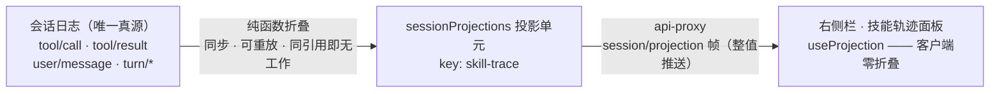

<div align="center">


# dsh-skill-tracer

**DeepSeek Harness 技能轨迹 —— 把每一次技能调用的过程与逻辑，画在官方右侧栏**

当模型通过 `skill` 工具加载技能、或你用 `/技能名` 显式调用时，右侧栏实时展开一张
"调用分镜"：谁加载了技能、加载之后依次做了哪些事、每一耗时多久、哪一步失败。

[](#-安装)
[](LICENSE)
[](#-兼容性)
[](#-兼容性)
[](#-开发与测试)

[特性](#-特性亮点) · [面板长什么样](#-面板长什么样) · [工作原理](#-工作原理) · [安装](#-安装) · [配置](#-配置) · [常见问题](#-常见问题)

</div>

---

## 🎯 这是什么

DSH（DeepSeek Harness）里的**技能（skill）**是模型按需加载的一套任务指令。加载是
一瞬间的事，但"加载之后模型怎么遵循这套指令工作"，在聊天流里只是散落的工具卡片。

本插件把这些**收敛成一条可视轨迹**，并坚持一个铁律：**会话日志是唯一真源**。
面板上的一切都是从已提交的会话事件折叠出来的 —— 人看到的和模型经历的，永远是
同一份数据。

## ✨ 特性亮点

- **两条调用路径全覆盖** —— 模型自主加载（`skill` 工具调用）与用户 `/名称` 手势，
  分别识别、分别标注；
- **阶段化的过程视图** —— 一次技能加载开启一个"阶段"，其后的普通工具调用嵌在该
  阶段之下，直到下一次加载；加载之前的归入"前置调用"；
- **实时** —— 宿主投影整帧推送，运行中的调用带脉冲高亮与秒表；轮次结束显示原因
  （完成 / 中断 / 出错）；
- **技能目录** —— 会话当前发布的可调用技能清单（名称 + 描述），折叠卡片呈现；
- **零模型侵入** —— 不注册任何 Agent 工具、不改提示词、不碰执行流水线；对 KV
  Cache 的影响为零；
- **零自定义事件** —— 只从既有事件类型派生状态，绝不向会话日志追加新类型（未带
  `ignorable` 标记的新类型会让会话拒绝重开）；
- **历史可回放** —— 重启后投影由注册表从日志重放重建，打开历史会话同样能看；
- **体积有闸** —— 状态是纯 JSON 且有裁剪上限（轮次数 / 条目数 / 描述长度），推送
  值永远保持 UI 量级。

## 🖥 面板长什么样

```
┌ 技能轨迹 ──────────────────────────── [ ● 进行中 ] ┐
│  技能 2 · 轮次 2        [ 自动打开 ✓ ]              │
│  ▸ 技能目录 (2)                                    │
│                                                    │
│  ┌ 轮次 2 · 14:32:10 –                [ 进行中 ] ┐ │
│  │ ╭───────────────────────────────────────╮   │ │
│  │ │ ● 调用技能  pdf:pdf        [用户 /名称] │   │ │
│  │ │   完成 · 2 次工具调用                   │   │ │
│  │ ╰───────────────────────────────────────╯   │ │
│  │   │ • read     完成    800ms                │ │
│  │   │ • bash     运行中  3s                   │ │
│  └────────────────────────────────────────────┘ │
│  ┌ 轮次 1 · 14:28:01 – 14:28:47      [ 已完成 ] ┐ │
│  │ ╭ ● 加载技能  pdf:pdf            [模型] ──╮  │ │
│  │ │   完成 · 1 次工具调用                  │  │ │
│  │ ╰──────────────────────────────────────╯  │ │
│  │   │ • read     完成    1.2s                │ │
│  │   │ • bash     失败    900ms   TOOL_FAILED │ │
│  └────────────────────────────────────────────┘ │
└────────────────────────────────────────────────────┘
```

- ● 状态点：蓝 = 运行中（脉冲），绿 = 完成，红 = 失败（附宿主错误码）；
- 每个技能节点左侧的品牌色竖条，就是"阶段"的边界；
- 深浅主题跟随宿主，全部使用官方 `--dsw-alias-*` 设计令牌。

## 🚪 三个入口

右栏的标签系统是"编辑器式"的：注册标签类型本身不产生任何可见入口，所以三个门
都由本插件显式搭好——

| 入口 | 位置 | 说明 |
|---|---|---|
| **会话头部按钮** | 聊天头部右侧的"技能轨迹"胶囊 | 一键打开 / 聚焦轨迹页 |
| **引导页入口** | 右栏展开按钮 → 罗盘引导页 → "技能轨迹"卡 | 带图标与描述的入口胶囊 |
| **自动打开**（默认开） | — | 出现新的技能调用且右栏收起时，自动展开到轨迹页；面板头部可关 |

> 提示：输入框里的 `/技能名` 是**技能手势**语法（触发技能），不是本插件的命令。
> 本插件不注册 slash 命令，轨迹页随会话自动更新，无需任何命令触发。

## ⚙️ 工作原理



- **Host 半**（`index.js` + `lib/trace.js`）注册一个会话投影单元。折叠是纯数学：
  对无关事件返回同一引用，重启后从日志重放重建，历史会话开箱即读；
- **Client 半**（`client.js`）照官方右栏契约接入：`sidebarRightTabs` 注册标签类型
  （含 `guide` 引导条目）、`sidebar.right.pane.tab` 槽渲染面板、
  `conversation.session.header.actions` 槽渲染常驻入口按钮并承担自动打开监视；
- 事件形状逐字段对齐真实 v4 会话日志与 `dsh-tool-skill` / `dsh-session` 源码；
  右栏接入契约解包自运行中应用的 `app.asar`（0.2.0-rc.2）逐行核实。

## 📦 安装

插件未发布 npm，走本地安装（与你已有的 dsh 插件同法）：

**方式一：desktop profile 手动安装**

```powershell
# 1) 复制本目录进 profile 的 node_modules
#    G:\工作\dsh\dsh-skill-tracer
#    -> C:\Users\Administrator\.dsh\profiles\desktop\node_modules\dsh-skill-tracer

# 2) 编辑 C:\Users\Administrator\.dsh\profiles\desktop\package.json：
#    dependencies 增加        "dsh-skill-tracer": "file:G:/工作/dsh/dsh-skill-tracer"
#    dsh.profile.bundles 增加 "dsh-skill-tracer"

# 3) 重启 DeepSeek Harness 桌面端
```

**方式二：会话内安装**

在 DSH 会话里让 Agent 使用 `plugin_manager` 工具（`action: install_bundle`），
目标为本插件目录 —— 官方安装路径，改动影响当前 profile 的所有会话。

## 🔧 配置

在 profile 的 `cordis.patch.yml` 里覆盖（用户补丁层升级不丢）：

```yaml
- id: skill-tracer
  name: dsh-skill-tracer
  config:
    maxTurns: 8                # 每会话保留的轮次数（最新优先，1–64）
    maxItems: 120              # 单轮次保留的条目数（最新优先，10–1000）
    catalogDescriptionMax: 200 # 技能目录单条描述的截断长度（40–500）
```

| 字段 | 默认值 | 含义 |
|---|---|---|
| `maxTurns` | `8` | 轨迹最多保留多少个轮次 |
| `maxItems` | `120` | 单个轮次最多保留多少条条目 |
| `catalogDescriptionMax` | `200` | 目录描述截断长度 |

## 🧪 开发与测试

```bash
node tools/trace-test.mjs   # 折叠逻辑：目录解析 / 模型加载 / 手势 / 结果配对 / 轮次闭合 / 裁剪上限
node tools/client-test.mjs  # 客户端契约：模块加载器形状 / 右栏注册 / 面板渲染 / 能力缺席降级
node --check index.js && node --check client.js && node --check lib/trace.js
```

两个测试都不依赖运行中的宿主：`trace-test` 用脚本化的事件序列断言投影状态；
`client-test` 模拟模块加载器与宿主上下文桩，并用 react-dom 渲染面板静态标记。

```
dsh-skill-tracer/
├── index.js          # Host 半：注册 sessionProjections 投影单元
├── lib/trace.js      # 核心：状态 schema + 事件折叠（纯函数）
├── lib/config.js     # 配置 schema（schemastery）与默认值收口
├── client.js         # Client 半：右栏标签页 + 引导入口 + 头部按钮 + 自动打开
├── cordis.patch.yml  # loader 行（insert: skill-tracer）
├── icon.svg          # 插件图标
└── tools/            # 离线自测脚本
```

## 🧩 兼容性

| 依赖 | 版本 | 说明 |
|---|---|---|
| DeepSeek Harness（Desktop） | `0.2.0-rc.2` | 右栏服务 `sidebarRight` / `sidebarRightTabs` 为 0.2.x 组合能力 |
| Node | `>= 22` | Host 半运行环境 |
| `zod` / `@deepseek-ai/schemastery` | 安装自带 | 从 dsh 安装投影解析，无需额外安装 |

旧版宿主（无右栏服务）里插件静默：不显示任何入口，也不影响其他功能。

## ⚠️ 已知边界

- **PTC mode**：`run_code` 程序内的子调用走 `tool/code-dispatch` 事件而非
  `tool/call`，这类调用不进轨迹（技能加载几乎总是原生单次调用，不受影响）；
- **子代理**：subagent 会话有独立日志，本版只展示当前会话的轨迹；
- **`arguments` 解析兜底**：技能名正常从 `skill` 调用的 JSON 参数解析，解析失败
  退化为正则提取 —— 只影响展示，不影响折叠本身。

## 🙏 致谢

- [NanmiCoder/dsh-agent-teams](https://github.com/NanmiCoder/dsh-agent-teams) ——
  右栏接入形状（标签类型 / 引导条目 / 头部入口）与工程组织方式均以其为成熟先例；
- dsh-asset-library —— 同一工作区里先行验证的 DSH 插件，本插件的懒绑定、自检与
  安装方式沿用了它的成熟做法。

## 📄 License

[MIT](LICENSE) © 2026 Hnqhj
